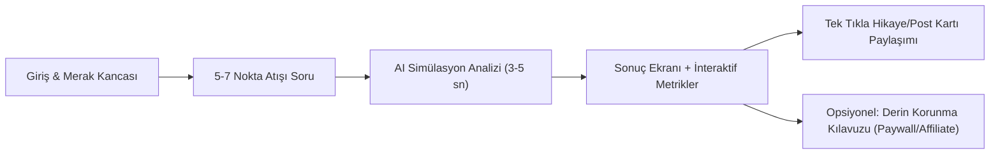

# Hayat Kırılmaları & Pişmanlık Önleme Simülatörü (Life Pivot / Next 5 Years)
**Proje Taslağı & Beyin Fırtınası Notları**

---

## 1. Ürün Özeti & Temel Tezi (Executive Summary)

* **Proje Adı (Geçici):** LifePivot / Next 5 Years / Kırılma Noktası Simülatörü
* **Format:** Web tabanlı, ultra hızlı, interaktif simülasyon ve görsel kart üretici.
* **Ana Fikir:** Kullanıcının mevcut kararlarını, alışkanlıklarını, kariyer/ilişki durumunu alıp önümüzdeki 3 ila 5 yıl içinde karşılaşacağı en kritik **kırılma noktalarını**, **tıkanma tuzaklarını** ve **en muhtemel pişmanlık senaryolarını** nokta atışı çıkaran bir AI simülatörü.
* **Temel Hedef:** Kişilik testleri (MBTI / 16Personalities) ve yıl sonu özetleri (Spotify Wrapped) gibi insanların sosyal medyada (Instagram Story, X, TikTok, WhatsApp grupları) gururla veya şaşkınlıkla paylaşacağı yüksek viral etkili bir ürün yaratmak.

---

## 2. Viral Kanca & Psikolojik Mekanik (The Hook)

1. **Barnum / Forer Etkisi + Soğuk Okuma (Cold Reading):**
   * Kullanıcılar genel geçer tavsiyelerden ("daha planlı olmalısın") sıkılmıştır.
   * *"3. yılda 'Altın Kelepçe' sendromu yaşayacaksın; maaşın iyi olacak ama kendi projene cesaret edemediğin için içten içe tükeneceksin"* gibi **rahatsız edici derecede spesifik** ifadeler güçlü bir şok ve paylaşma arzusu yaratır.
2. **Sosyal Sinyal & Kimlik İnşası:**
   * "Beni benden iyi anlattı" duygusu.
   * Mizah / Trajikomik paylaşım ("3. yılda burnout garantiliyim arkadaşlar").
   * Kendi geleceğiyle ilgili statü/endişe sinyali verme.

---

## 3. Artılar ve Eksiler Analizi

### Güçlü Yönler (Artılar)
* **Yüksek Viralite (K-Factor > 1):** Ürünün içine gömülü estetik paylaşım kartları sayesinde sıfır reklam bütçesiyle organik yayılma potansiyeli.
* **Hızlı Geliştirme (MVP 3–5 Gün):** Karmaşık backend altyapısı gerektirmez; güçlü bir prompt mimarisi + Next.js frontend + dinamik kart render (`@vercel/og` veya HTML canvas) yeterlidir.
* **Büyük ve Hazır Kitle:** 20–35 yaş arası (kariyer kararsızlığı, iş-özel hayat dengesi, "kendi işimi kursam mı" ikilemi yaşayan kitle).
* **Sıfır Regülasyon/Yasal Engel:** Eğlence ve içgörü/simülasyon kategorisinde olduğu için lisans veya yasal kısıt bulunmaz.

### Riskler & Gizli Tuzaklar (Eksiler)
* **Tek Seferlik Kullanım (One-and-Done / Düşük Retention):** Kullanıcı testi çözer, kartı paylaşır ve siteye tekrar dönme ihtiyacı hissetmeyebilir.
* **Klişe LLM Cevapları Tehlikesi:** Prompt mühendisliği zayıf kalırsa sıradan ve sıkıcı ChatGPT tavsiyelerine dönüşür ve viral büyü bozulur.
* **B2C Ödeme Bariyeri:** Kullanıcılar eğlence testlerine para ödemede dirençlidir; gelir kapısı net ayrıştırılmalıdır (ücretsiz viral özet vs. ücretli derin eylem raporu).

---

## 4. Fark Yaratan Özellikler (Feature Ideas)

* **Multiverse Modu (Çift Zaman Çizgisi):**
  * *Çizgi A:* "Mevcut düzeni korursan ne olur?"
  * *Çizgi B:* "Kafandaki o radikal kararı alırsan ne olur?"
  * İki paralel hayatın 3. ve 5. yıl kırılmalarını yan yana kıyaslama.
* **Kritik Metrikler (Radar / Stats Bar):**
  * *Pişmanlık Katsayısı:* Örn. `%74`
  * *Konfor Alanı Çürümesi:* Kritik Seviye
  * *3. Yıl Darboğazı:* "Mikro Yönetim & Delege Edememe"
  * *Gizli Kör Nokta:* "Görünmeyen Finansal Sızıntı"
* **Story & Post Formatında Bento Grid Kartı:**
  * Cyberpunk / Minimalist karanlık modda, kullanıcının ismi ve fütüristik simülasyon damgalarıyla tasarlanmış paylaşılabilir kart.

---

## 5. Örnek Kullanıcı Akışı (User Flow)

### Örnek Soru Tipleri (Maksimum 5–7 Soru):
1. Şu anki ana odak noktan ve en büyük ikilemin ne?
2. Konfor alanından çıkma eşiğin ne kadar yüksek? (1-10)
3. Gelecekle ilgili seni geceleri en çok uyanık tutan korku ne? (Finansal çöküş, vasatlaşma, zamanın boşa akması)
4. Karar alırken mantık mı yoksa ani hisler mi baskın?
5. Kafanda ertelediğin o "büyük adım" ne zamandır bekliyor?

---

## 6. Gelir Modeli (Monetizasyon)

1. **Freemium Deep Report:**
   * *Ücretsiz:* 3. yıl kırılma özeti + görsel sosyal medya kartı.
   * *Ücretli (Tek Seferlik Micro-payment: 79–149 TL / $4.99):* "5 Yıllık Pişmanlık Önleme & Riskten Kaçınma Eylem Kılavuzu" (Kişiselleştirilmiş PDF dökümü).
2. **Affiliate & Partner Yönlendirmeleri:**
   * Kariyer/Eğitim platformları, finans/bütçe uygulamaları, üretkenlik araçları.

---

## 7. Önerilen Teknoloji Yığını (Tech Stack)

* **Frontend:** Next.js (App Router), Tailwind CSS, Framer Motion (akıcı animasyonlar).
* **AI Katmanı:** Google Gemini 1.5 Flash / Pro (hızlı yanıt ve yapılandırılmış JSON çıktısı).
* **Kart Üretimi:** `@vercel/og` (Edge tabanlı anlık dinamik görsel üretimi) veya `html2canvas` / `satori`.
* **Depolama / Analytics:** Supabase veya Vercel KV (simülasyon anonim istatistikleri ve paylaşımları için).

---

## 8. Karar & Sonraki Adımlar

- [ ] **Soru Seti ve JSON Prompt Şemasının Kesinleştirilmesi**
- [ ] **Görsel Kart Tasarımı (UI Mockup)**
- [ ] **MVP Kodlaması & Canlıya Alma**
- [ ] **X / Instagram / TikTok Üzerinde İlk Test Dalgası**
